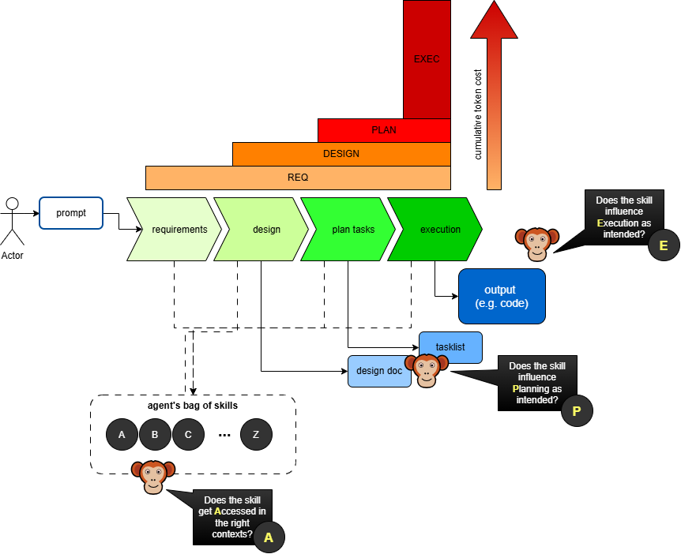

# Springboot Openapi Generator skill

This repo contains a skill in the standard agentskills.io format that will guide a code generating LLM working on a Springboot project with maven to use the [openapi-generator maven plugin](https://openapi-generator.tech/docs/generators/spring/) when creatimg code based on a rest interface, rather than manually generating controllers, request and response objects.

Specifically, it follows a set of conventions for that plugin that will put the majority of code generated into the generated-sources folder, with an ApiDelegate committed into src/main/java, to which business logic can be attached.

The skill has been tuned to provide guidance on how to navigate the maven code generation phase, as early attempts of using the skill tended to run into problems.

## Advantages to this approach

- less code committed into the repo, translating to less unit test coverage and other maintenance.
- cheaper token cost for delivery of the same (or better) value
- more consistent output, as the generated code follows a templated pattern. If you need to build 20 microservices from swagger, then this way they'll all look the same, whereas manually-generated LLM code will vary.

## Testing and Evaluating Skills

Having created this skill, it's important to verify that it actually does what we want it to do, and this repo contains some simple evaluation harnesses. Note the use of the word evaluation rather than test. Automated test suites are deterministic, and LLM-driven systems, including skills, aren't.  

### A.P.E. Testing Levels

There's at least three levels to evaluating an Agent Skill (which handily spell out the acronym A.P.E. - so there we go, it's got a name now.

| **Level** | **Purpose** | **Cost** |
|---|---|---|
| [Activation](./test/skill-activation/README.md) | Does the skill get picked up in the right context? Have I drafted the front matter correctly, and can my LLM of choice understand it? | Low - just feed sample prompts that you expect would or wouldn't activate the skill |
| [Planning](./test/tasklist-eval/README.md) | If my skill influences the organisation of my work, does it do so correctly? Does application of the skill result in a well-formed task list? Not all skills will apply here, but many will. For example, a skill encoding TDD, or git branching will impact task list structure, whereas a skill solely providing code formatting instructions or variable naming won't. | Medium - need to use the skill to generate tasklists, but this is typically much cheaper than generating all the code. |
| Execution (TODO - no demo yet) | Does my skill shape the finished result correctly? I'm mostly thinking in the context of skills used in code generation, so this question would be a matter of code review, but it will apply in other areas too. Necessary to check that the skill doesn't plan out a perfect task list and then deviate, but also to check that it can actually use the tools it says it will. The openapi generator skill [initially fell over a lot](https://www.linkedin.com/pulse/cool-headed-ai-practice-openapi-generator-dave-crane-bmcqe/) failing to understand maven codegen lifecycle, until [some extra help](./steering/build-and-codegen.md) was provided.  | High - need to excute the task to completion before evaluating | 

### When to Execute

Evals can be executed at different times

| **Time** | **Frequency** | **Description** |
|---|---|---|
| Skill Changes | Low | When the skill itself is changed, run the evals to assess impact of the changes |
| Model Changes | Medium | The skill isn't changed, but the model against which it's beibg executed is. Your organisation has signed a new deal with a vendor, or moved to in-house open-weights model. Or the vendor's released a new version of the model. Does it still perform as expected |
| Live Usage | High | Capture the real-world usage of the skill, using a telemetry system such as langFuse, Comet Opik or Arize Phoenix. Ensure the data is correctly marked with the skill version and model, and run evaluators and experiments against the live data to understand how if changes.    Unlike Skill and Model changes, there's a risk here as we're measuring after it's seen real world use. In the case of code generation, this risk is lower than for customer-facing chatbots. Good option cost-wise for testing execution, as we don't incur the cost of extra executions solely for the eval. |